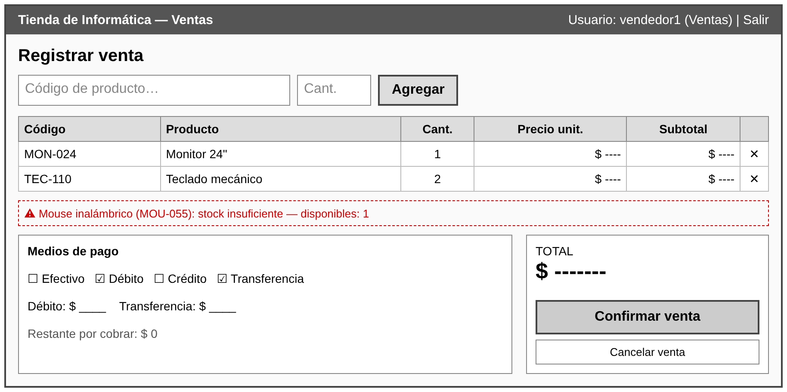

## 1. Introducción y conexión con el dominio

En esta entrega final terminamos el trabajo de Ingeniería de Requerimientos sobre el sistema de gestión para la tienda de informática que definimos en la Entrega 1. Partimos de los stakeholders, la planificación de la elicitación y las cualidades del software que priorizamos en la Entrega 2 y ahora especificamos los requerimientos, modelamos el comportamiento del sistema y definimos el vocabulario del dominio. Además, tratamos de que cada requerimiento se pueda relacionar con su origen.

## 2. Necesidades, deseos y expectativas de los usuarios

Para reducir la brecha entre el negocio y el software, clasificamos lo que relevamos en la elicitación:

- **Necesidad (crítica e indispensable):** el sistema tiene que avisar cuando un producto llega a su stock mínimo. Sin esto, el negocio pierde ventas por falta de mercadería. (Encargado de Compras)

- **Deseo (valor agregado, no vital):** el personal de ventas quiere que la interfaz tenga un "modo oscuro" para cansar menos la vista durante el turno. (Ventas)

- **Expectativa (se da por hecho):** el gerente espera que al confirmar una venta el stock se actualice al instante, sin tener que refrescar la pantalla. (Administración)

## 3. Requerimientos del usuario vs. requerimientos del sistema

- **Requerimientos del usuario:** se escriben en lenguaje natural, desde el punto de vista del usuario. Dicen qué necesita hacer con el sistema, sin detalles técnicos.

- **Requerimientos del sistema:** son los requerimientos del usuario, pero más detallados y verificables. Establecen las funciones, reglas y restricciones que el sistema tiene que cumplir. Igual siguen diciendo el "qué” y no el "cómo" (las tablas, APIs o tecnologías son decisiones de diseño).

A continuación, cada requerimiento del usuario con su requerimiento del sistema correspondiente:

- **RU01:** El vendedor debe poder cobrar una venta con uno o más medios de pago (efectivo, débito, crédito o transferencia), combinándolos si el cliente lo pide.

  - **RS01:** El sistema debe permitir cargar en una misma venta uno o más pagos, cada uno con su medio e importe. La venta solo se puede confirmar cuando la suma de los pagos es igual al total. Al confirmarla, el sistema emite el comprobante fiscal electrónico según la normativa de ARCA.

- **RU02:** El encargado de compras debe saber cuándo un producto está por agotarse para pedir más.

  - **RS02:** El sistema debe generar una alerta de reposición en el módulo de Compras cuando la cantidad disponible de un producto sea menor o igual a su stock mínimo.

- **RU03:** El gerente debe poder ver un resumen de las ventas del día.

  - **RS03:** El sistema debe mostrar en el módulo de Administración un resumen de ventas por día o por período (cantidad de ventas, importe total y total por medio de pago) y permitir exportarlo a PDF o Excel.

## 4. Requerimientos funcionales (RF) y no funcionales (RNF)

**Requerimientos funcionales**: Tratamos de que cada uno tenga una sola función y entre paréntesis ponemos de dónde sale:

- **RF01:** El sistema muestra la descripción, el precio y la cantidad disponible de un producto a partir de su código. (HU01)

- **RF02:** El sistema registra una venta con uno o más productos y uno o más medios de pago. (RU01, CU01)

- **RF03:** El sistema emite el comprobante fiscal electrónico de cada venta confirmada. (RU01, CU01)

- **RF04:** El sistema descuenta del stock la cantidad vendida de cada producto al confirmar la venta. (CU01)

- **RF05:** El sistema genera una alerta de reposición cuando la cantidad disponible de un producto es menor o igual a su stock mínimo. (RU02, CU02, HU02)

- **RF06:** El sistema genera y envía la orden de compra al proveedor elegido. (CU02)

- **RF07:** El sistema muestra el resumen de ventas por día o período y lo exporta a PDF o Excel. (RU03, HU03)

**Requerimientos no funcionales**: Mantenemos el orden de prioridad de las cualidades que definimos en la Entrega 2:

- **RNF01 (Confiabilidad – prioridad 1):** una venta se confirma completa o no se confirma. Si falla el cobro, la emisión del comprobante o el sistema, no se registra la venta ni se modifica el stock.

- **RNF02 (Usabilidad – prioridad 2):** un vendedor nuevo puede registrar una venta después de una capacitación de 2 horas como máximo.

- **RNF03 (Seguridad – prioridad 3):** para entrar a cada módulo hay que autenticarse con usuario y contraseña y los permisos dependen del rol (Ventas, Depósito, Compras, Administración).

- **RNF04 (Rendimiento – prioridad 4):** la consulta de un producto responde en 2 segundos como máximo.

## 5. Etapas de la Ingeniería de Requerimientos y prototipado

1.  **Elicitación:** es descubrir las necesidades, se trabaja con los stakeholders para sacar el conocimiento explícito y el tácito.

2.  **Análisis y negociación:** se buscan conflictos, cosas que faltan y ambigüedades entre lo que piden las distintas áreas y se acuerdan prioridades. Por ejemplo, Ventas y Compras tienen que ponerse de acuerdo en quién define el stock mínimo.

3.  **Especificación:** es pasar lo elicitado a modelos formales o semiformales (LEL, casos de uso, historias de usuario) y dejar una línea base clara y sin ambigüedades.

4.  **Validación:** es confirmar con el cliente que lo que especificamos es lo que realmente necesita ("hacer el software correcto").

5.  **Gestión de requerimientos:** es controlar los cambios durante el proyecto y mantener la trazabilidad.

**Utilidad de los prototipos:** los prototipos son muy útiles para validar de manera temprana, reducen la incertidumbre, hacen más fácil que el usuario dé su opinión y evitan programar cosas que no resuelven el problema real. Corregir un requerimiento en esta etapa es mucho más barato que hacerlo cuando el sistema ya está programado.

Como ejemplo, hicimos un prototipo de baja fidelidad de la pantalla "Registrar venta" para validarlo con los vendedores. Muestra la carga de varios productos, el aviso de stock insuficiente y el cobro con más de un medio de pago:

*Figura 1: Prototipo de la pantalla "Registrar venta"*

## 6. Léxico Extendido del Lenguaje

**Dominio:** Tienda de informática.

1.  **Sujeto: VENDEDOR**

    - **Noción:** Empleado del área de Ventas que atiende al cliente en el local.

    - **Impacto:** Consulta la disponibilidad de un producto. Vende productos al cliente. Entrega el comprobante fiscal.

2.  **Sujeto: ENCARGADO DE COMPRAS**

    - **Noción:** Empleado del área de Compras que se encarga del abastecimiento y de la relación con los proveedores.

    - **Impacto:** Define el stock mínimo de cada producto. Atiende las alertas de reposición. Emite la orden de compra.

3.  **Sujeto: CLIENTE**

    - **Noción:** Persona que compra productos en el local.

    - **Impacto:** Elige los productos. Paga con uno o más medios de pago. Recibe el comprobante fiscal.

4.  **Sujeto: PROVEEDOR**

    - **Noción:** Empresa que le vende productos a la tienda.

    - **Impacto:** Recibe la orden de compra. Entrega la mercadería al Depósito.

5.  **Objeto: PRODUCTO**

    - **Noción:** Artículo informático que vende la tienda. Tiene código, marca, categoría, precio y cantidad disponible.

    - **Impacto:** Se vende al cliente. Su cantidad disponible baja al venderse y sube al reponerse.

6.  **Objeto: STOCK MÍNIMO**

    - **Noción:** Cantidad de unidades de un producto a partir de la cual hay que reponerlo.

    - **Impacto:** Lo define el encargado de compras. Cuando se alcanza, el producto pasa a en punto de reposición.

7.  **Objeto: ALERTA DE REPOSICIÓN**

    - **Noción:** Aviso que indica que un producto llegó a su stock mínimo.

    - **Impacto:** Se genera cuando el producto pasa a en punto de reposición o sin stock. El encargado de compras la atiende emitiendo una orden de compra.

8.  **Objeto: COMPROBANTE FISCAL**

    - **Noción:** Documento legal electrónico que certifica una venta, emitido según la normativa de ARCA.

    - **Impacto:** Se emite al confirmar la venta. El vendedor se lo entrega al cliente.

9.  **Objeto: ORDEN DE COMPRA**

    - **Noción:** Documento que formaliza el pedido de productos a un proveedor.

    - **Impacto:** La emite el encargado de compras. Se envía al proveedor. Cuando llega la mercadería, se repone el producto.

10. **Verbo: VENDER**

    - **Noción:** Acción en la que el vendedor le entrega productos al cliente a cambio de su pago.

    - **Impacto:** Se cobra el importe con uno o más medios de pago. Se emite el comprobante fiscal. Baja la cantidad disponible de cada producto vendido.

11. **Verbo: REPONER**

    - **Noción:** Acción de pedir y recibir productos de un proveedor para recuperar el stock.

    - **Impacto:** Se emite una orden de compra. Depósito registra el ingreso de la mercadería. El producto vuelve a disponible.

12. **Estado: DISPONIBLE**

    - **Noción:** Situación de un producto cuya cantidad disponible es mayor que su stock mínimo.

    - **Impacto:** Se puede vender normalmente. Pasa a en punto de reposición si una venta lo deja en su stock mínimo o por debajo.

13. **Estado: EN PUNTO DE REPOSICIÓN**

    - **Noción:** Situación de un producto cuya cantidad disponible es mayor que cero y menor o igual a su stock mínimo.

    - **Impacto:** Se genera la alerta de reposición. Todavía se puede vender. Vuelve a disponible al reponerse.

14. **Estado: SIN STOCK**

    - **Noción:** Situación de un producto cuya cantidad disponible es cero.

    - **Impacto:** No se puede vender. La alerta de reposición sigue activa. Vuelve a disponible al reponerse.

## 7. Especificación de Casos de uso

<table>
<thead>
<tr class="header">
<th colspan="2"><strong>CU01: Registrar venta</strong></th>
</tr>
</thead>
<tbody>
<tr class="odd">
<td><strong>Actor principal</strong></td>
<td>Vendedor.</td>
</tr>
<tr class="even">
<td><strong>Actores secundarios</strong></td>
<td>Entidad de cobro y servicio de facturación electrónica de ARCA.</td>
</tr>
<tr class="odd">
<td><strong>Descripción</strong></td>
<td>Registrar la venta de uno o más productos a un cliente y emitir su comprobante fiscal.</td>
</tr>
<tr class="even">
<td><strong>Precondición</strong></td>
<td>El vendedor inició sesión con el rol Ventas.</td>
</tr>
<tr class="odd">
<td><strong>Flujo principal</strong></td>
<td>
1. El vendedor inicia una nueva venta.

2. El vendedor ingresa el código de un producto y la cantidad.

3. El sistema verifica la disponibilidad, muestra la descripción y el precio, y agrega el producto al detalle.

4. Se repiten los pasos 2 y 3 por cada producto que quiera comprar el cliente.

5. El sistema muestra el total de la venta.

6. El vendedor selecciona uno o más medios de pago e ingresa el importe de cada uno.

7. Para los pagos con tarjeta, el sistema pide la autorización a la entidad de cobro, que la aprueba.

8. El vendedor confirma la venta.

9. El sistema registra la venta, descuenta el stock de cada producto y emite el comprobante fiscal.

10. El vendedor le entrega el comprobante al cliente.
</td>
</tr>
<tr class="even">
<td><strong>Flujos alternativos</strong></td>
<td>
<strong>Stock insuficiente:</strong>

3.1 El sistema informa la cantidad disponible.

3.2 El vendedor cambia la cantidad o quita el producto y sigue en el paso 4.

<strong>Tarjeta rechazada:</strong>

7.1 El sistema informa el rechazo.

7.2 El vendedor elige otro medio de pago y vuelve al paso 6.

<strong>Falla en la facturación electrónica:</strong>

9.1 El sistema informa el error y no confirma la venta ni modifica el stock (RNF01).

9.2 El vendedor reintenta y vuelve al paso 8.
</td>
</tr>
<tr class="odd">
<td><strong>Postcondición</strong></td>
<td>La venta queda registrada, baja el stock de cada producto y se emite el comprobante fiscal.</td>
</tr>
</tbody>
</table>

<table>
<thead>
<tr class="header">
<th colspan="2"><strong>CU02: Reponer mercadería</strong></th>
</tr>
</thead>
<tbody>
<tr class="odd">
<td><strong>Actor principal</strong></td>
<td>Encargado de Compras.</td>
</tr>
<tr class="even">
<td><strong>Actor secundario</strong></td>
<td>Proveedor.</td>
</tr>
<tr class="odd">
<td><strong>Descripción</strong></td>
<td>Emitir una orden de compra para un producto con alerta de reposición.</td>
</tr>
<tr class="even">
<td><strong>Precondición</strong></td>
<td>El encargado de compras inició sesión con el rol Compras y hay al menos una alerta de reposición activa.</td>
</tr>
<tr class="odd">
<td><strong>Flujo principal</strong></td>
<td>
1. El encargado de compras abre el panel de alertas de reposición.

2. El sistema lista los productos en punto de reposición o sin stock, con su cantidad disponible y su stock mínimo.

3. El encargado de compras selecciona un producto.

4. El sistema muestra los proveedores asociados al producto y el último precio de compra de cada uno.

5. El encargado de compras selecciona un proveedor e ingresa la cantidad a pedir.

6. El sistema genera la orden de compra y la envía al proveedor.

7. El sistema marca la alerta como "en gestión".
</td>
</tr>
<tr class="even">
<td><strong>Flujos alternativos</strong></td>
<td>
<strong>El producto no tiene proveedores asociados:</strong>

4.1 El sistema lo informa. 4a.2 El encargado de compras cancela la operación y la alerta sigue activa.

<strong>El proveedor elegido no tiene la cantidad necesaria:</strong>

5.1 El encargado de compras elige otro proveedor asociado y vuelve al paso 5.
</td>
</tr>
<tr class="odd">
<td><strong>Postcondición</strong></td>
<td>La orden de compra queda registrada y la alerta queda "en gestión". La alerta se cierra cuando Depósito registra el ingreso de la mercadería.</td>
</tr>
</tbody>
</table>

## 8. Historias de usuario y criterios de aceptación

### HU01 - Consulta de stock (Ventas)

- **Historia:** Como vendedor, quiero consultar la disponibilidad y el precio de un producto con su código, con el fin de informarle al cliente en el momento.

- **Criterio 1 (producto existente):** Dado que el vendedor ingresa un código de producto que existe, cuando presiona "Consultar", entonces el sistema muestra la descripción, el precio y la cantidad disponible en 2 segundos como máximo.

- **Criterio 2 (código inexistente):** Dado que el vendedor ingresa un código que no existe, cuando presiona "Consultar", entonces el sistema muestra el mensaje "Producto no encontrado".

### HU02 - Alertas de reposición (Compras)

- **Historia:** Como encargado de compras, quiero ver una alerta cuando un producto llega a su stock mínimo, con el fin de pedirles mercadería a los proveedores a tiempo.

- **Criterio 1 (llega al stock mínimo):** Dado un producto con stock mínimo 5 y cantidad disponible 7, cuando se confirma una venta de 3 unidades, entonces el producto aparece resaltado en la sección "Alertas de reposición" con cantidad disponible 4.

- **Criterio 2 (no llega al stock mínimo):** Dado un producto con stock mínimo 5 y cantidad disponible 10, cuando se confirma una venta de 2 unidades, entonces no se genera ninguna alerta.

### HU03 - Resumen de ventas (Administración)

- **Historia:** Como gerente de administración, quiero ver el resumen de ventas de un día o de un período y exportarlo, con el fin de controlar cómo le va comercialmente a la tienda.

- **Criterio 1 (resumen del día):** Dado que el gerente está en el panel de reportes, cuando selecciona la fecha de hoy, entonces el sistema muestra la cantidad de ventas, el importe total y el total por medio de pago.

- **Criterio 2 (exportación):** Dado que el gerente eligió un período, cuando selecciona "Exportar a Excel", entonces el sistema descarga un archivo .xlsx con el detalle de las ventas de ese período.

## 9. Uso de Inteligencia Artificial (imagen de portada del podcast)

- **Herramienta utilizada:** Gemini 4 Argon - Nano Banana Pro

- **Prompt empleado:** "A professional and serious cover art for an academic engineering podcast named 'Podcast del Ingeniero'. The design features subtle technological elements like a computer motherboard seamlessly integrated with a modern studio microphone. The color palette is deep navy blue and silver. Vector art style, high quality, corporate and academic aesthetic."

- **Justificación de la elección:** elegimos un diseño que junta la comunicación oral con el hardware, que representa a la tienda de informática del caso de estudio. Los colores azul marino y plateado le dan un aspecto serio, acorde a la Ingeniería de Sistemas.

## 10. Guion del Podcast · Episodio 2 (final)

**Duración estimada:** 5 a 6 minutos.

*(Música de entrada)*

**Agustín:** ¡Hola a todos y bienvenidos al segundo y último episodio del "Podcast del Ingeniero"! Somos estudiantes de Ingeniería en Sistemas de la Universidad Abierta Interamericana, de la materia Ingeniería de Requerimientos, con la profesora Marcela Samela. Soy Agustín Gómez y me acompañan…

**Carlos:** Carlos Cativa…

**Gonzalo:** Gonzalo Castañeda…

**Nahuel:** … y Nahuel Cerrano. ¡Buenas!

**Agustín:** En el episodio anterior identificamos a los stakeholders de nuestra tienda de informática, planificamos la elicitación y priorizamos las cualidades del software. Hoy cerramos con la especificación. Carlos, ¿por dónde arrancamos?

**Carlos:** Por ordenar lo que relevamos. Distinguimos tres cosas: las necesidades, que son indispensables, como la alerta cuando un producto llega a su stock mínimo; los deseos, que suman, pero no son vitales, como un modo oscuro para los vendedores; y las expectativas, lo que el usuario da por hecho sin decirlo, como que el stock se actualice solo al confirmar una venta.

**Gonzalo:** Después lo escribimos en dos niveles. El requerimiento de usuario habla el idioma del negocio: "el gerente necesita ver las ventas del día". El requerimiento de sistema es esa misma necesidad, pero detallada y verificable: "el sistema muestra un resumen diario con la cantidad de ventas, el total y lo cobrado por cada medio de pago". Ojo, sigue siendo un qué, no un cómo: la base de datos es una decisión de diseño.

**Nahuel:** De ahí salen los requerimientos funcionales, lo que el sistema hace, como registrar una venta o emitir una orden de compra y los no funcionales, cómo lo hace. Respetamos la prioridad del primer episodio: primero la confiabilidad, una venta se confirma completa o no se confirma; después usabilidad, seguridad y rendimiento.

**Agustín:** Y cada requerimiento indica de dónde viene. Eso es la trazabilidad. Gonzalo, ¿qué camino recorrimos para llegar acá?

*(Transición)*

**Gonzalo:** Las etapas de la Ingeniería de Requerimientos. Elicitación, donde descubrimos las necesidades. Análisis y negociación, donde resolvemos conflictos entre áreas. Especificación, donde lo escribimos sin ambigüedades. Validación, donde confirmamos con el cliente que es lo que necesita. Y la gestión, que controla los cambios durante todo el proyecto.

**Carlos:** Para validar armamos un prototipo de la pantalla "Registrar venta". El vendedor la mira, opina y si algo no le sirve lo corregimos antes de programar, que es cuando corregir sale más barato.

**Agustín:** Pero para validar con el cliente hay que hablar el mismo idioma. Nahuel.

*(Transición)*

**Nahuel:** Ese es el problema de la brecha semántica: el negocio y los desarrolladores usan palabras distintas, o la misma palabra con significados distintos. Para reducirla escribimos en lenguaje natural con reglas, sujeto, verbo y objeto en voz activa y armamos el Léxico Extendido del Lenguaje, el LEL.

**Carlos:** Cada símbolo del LEL tiene una noción, qué es y un impacto, qué hace o qué produce. Y se clasifica como sujeto, objeto, verbo o estado.

**Nahuel:** Y nos sirvió para corregirnos. Al principio dijimos que el estado "sin stock" disparaba la alerta, pero la alerta salta antes, al llegar al stock mínimo. Por eso definimos tres estados: disponible, en punto de reposición y sin stock. Esa precisión es justamente lo que aporta el LEL.

**Agustín:** Mu y bueno. Con el vocabulario claro, pasamos a los modelos. Gonzalo.

*(Transición)*

**Gonzalo:** Especificamos casos de uso. En "Registrar venta" el actor principal es el vendedor y hay actores secundarios: la entidad de cobro, que autoriza la tarjeta y ARCA, para el comprobante. El flujo principal es el camino feliz: carga los productos, cobra y emite el comprobante. Los flujos alternativos cubren lo que puede salir mal: stock insuficiente, una tarjeta rechazada o una falla en la facturación.

**Nahuel:** Como complemento ágil sumamos historias de usuario. Por ejemplo: "Como encargado de compras, quiero ver una alerta cuando un producto llega a su stock mínimo, para pedir mercadería a tiempo".

**Carlos:** Y cada historia tiene criterios de aceptación en formato Gherkin: dado, cuando, entonces. Por ejemplo: dado un producto con stock mínimo cinco y siete unidades, cuando se venden tres, entonces aparece en alertas de reposición. Así cualquiera puede probar si se cumple.

*(Transición)*

**Agustín:** Para cerrar: en estos dos episodios pasamos de un enunciado a una especificación con requerimientos trazables, un LEL compartido y modelos listos para validar.

**Gonzalo:** Lo que más nos quedó: un requerimiento ambiguo sale caro y se detecta escribiendo con precisión y validando temprano.

**Nahuel:** Y que no se trata de documentar por documentar, sino de entender al usuario.

**Carlos:** Gracias a la profesora Samela por acompañarnos durante el cuatrimestre y a ustedes por escucharnos.

**Agustín:** ¡Esto fue el "Podcast del Ingeniero"! Hasta la próxima.

*(Música de salida)*

## 11. Enlace al podcast

Episodio 2: [Podcast](https://open.spotify.com/episode/6bPAzh4uvHdl3QyKGllvKE?si=xzuZ5S1BRYyvvl5AcYc7Qw)

## 12. Conclusión

Con esta entrega terminamos el recorrido de la Ingeniería de Requerimientos sobre la tienda de informática: arrancamos por el dominio, identificamos a los stakeholders, elicitamos sus necesidades y las especificamos como requerimientos de usuario y de sistema, funcionales y no funcionales. El LEL nos ayudó a unificar el vocabulario y a darnos cuenta de errores, como la diferencia entre "sin stock” y "en punto de reposición". Con los casos de uso, las historias de usuario y el prototipo, la especificación queda lista para validarla con el cliente. Además, la trazabilidad entre las tres entregas muestra que cada requerimiento responde a una necesidad real del negocio.

---

Viene de la [Entrega 2](/trabajos/tp-integrador-entrega-2/).
